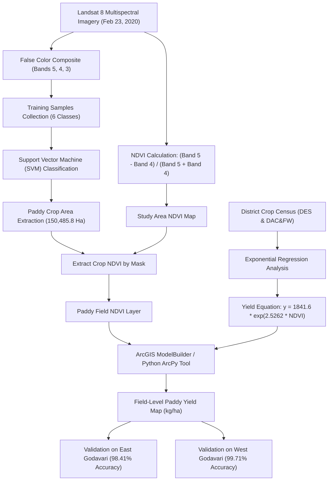

# Creation of Crop Yield Estimation Model Using Geo-Spatial Technology

[](https://www.python.org/)
[](LICENSE)
[]()
[]()

> **B.Tech Project Report** submitted in partial fulfillment of the requirements for the award of the degree of **Bachelor of Technology in Geo-Informatics Engineering**  
> **Department of Geo-Engineering & RDT, Andhra University College of Engineering (A), Visakhapatnam (2022–2023)**

---

## 👥 Authors & Supervision

- **Student Authors**:
  - **Baipilli Naveen** (Regd. No. `319106715004`)
  - **Avupati Ajay** (Regd. No. `319106715002`)
  - **Marrapu Sai Meghana** (Regd. No. `319106715042`)
  - **Pothuraju Pooja** (Regd. No. `319106715056`)
  - **Devu Phanindra Sai Kumar** (Regd. No. `319106715070`)
- **Project Guide**: **Prof. Murali Krishna Gurram**, Department of Geo-Engineering & RDT, AUCE(A)
- **Head of the Department**: **Prof. Vazeer Mahammood**, Department of Geo-Engineering & RDT, AUCE(A)

---

## 🌾 Abstract & Research Overview

Accurate and timely estimation of regional crop yield is critical for agricultural management, food security planning, supply-chain logistics, and farmer financial risk mitigation. Traditional yield estimation via field crop surveys and Crop Cutting Experiments (CCEs) is labour-intensive, costly, and subject to post-harvest reporting delays.

This project proposes a remote sensing and GIS-based methodology to estimate paddy (*Oryza sativa*) crop yield at the field scale using single-date multispectral satellite imagery (**Landsat 8 OLI/TIRS**). The study was executed across the Godavari delta of Andhra Pradesh, India:
1. **Model Development**: **East Godavari District** ($14,266.85\,\text{km}^2$, WGS 1984 UTM Zone 44N)
2. **Model Validation**: **West Godavari District** ($2,178\,\text{km}^2$)

By coupling supervised **Support Vector Machine (SVM)** land cover classification with peak vegetative **Normalized Difference Vegetation Index (NDVI)** and district agricultural statistics, an empirical exponential yield equation was formulated:
$$\text{Yield } (\text{kg/hectare}) = 1841.6 \times e^{2.5262 \times \text{NDVI}} \quad (R^2 = 0.9922)$$

An automated geoprocessing tool was developed in **ArcGIS ModelBuilder** (`Rice_Yield.tbx`) and Python (`ArcPy` / `Rasterio`), taking crop NDVI as a single raster input to generate continuous field-level yield maps.

---

## 📊 Key Highlights & Accuracy Metrics

| Target Evaluation | Study Area | Ground Truth Value | Model Estimated Value | Percentage Accuracy ($P_a$) |
|---|---|---|---|---|
| **Paddy Cultivated Area** | East Godavari | $166,544.0\,\text{Ha}$ | $150,485.8\,\text{Ha}$ | **90.35%** |
| **Paddy Crop Yield** | East Godavari | $5,333.55\,\text{kg/ha}$ | $5,418.36\,\text{kg/ha}$ | **98.41%** |
| **Spatial Transferability Validation** | West Godavari | $5,394.66\,\text{kg/ha}$ | $5,379.22\,\text{kg/ha}$ | **99.71%** |
| **Regression Fit** | Godavari Delta | — | — | **$R^2 = 0.9922$** |

---

## 🔄 Methodological Pipeline



---

## 🗂 Repository Structure

```
Btech_thesis/
├── .github/
│   └── workflows/
│       └── ci.yml                 # Automated CI workflow running unit tests & pipeline
├── arcgis_toolbox/                # ArcGIS integration
│   ├── README.md                  # ArcMap / ArcGIS Pro tool import and setup guide
│   ├── Rice_Yield_Model.py        # Standalone ArcPy script tool
│   └── rice_yield_spec.json       # Geoprocessing tool parameter schema
├── data/
│   ├── README.md                  # Data overview & management policies
│   ├── raw/
│   │   ├── boundaries/README.md   # Administrative boundary shapefile guide
│   │   ├── landsat8/README.md     # Landsat 8 OLI scene acquisition details
│   │   └── statistics/            # Rabi 2019-2020 crop census records
│   │       ├── crop_statistics_ap_rabi_2019_2020.csv
│   │       └── README.md
│   └── processed/                 # Intermediate outputs (.gitkeep)
│       ├── fcc/
│       ├── ndvi/
│       └── yield_maps/
├── docs/                          # Comprehensive academic documentation
│   ├── methodology_workflow.md    # Step-by-step remote sensing & GIS workflow
│   ├── mathematical_formulation.md# NDVI derivation, exponential model, & accuracy formulas
│   ├── study_area.md              # East Godavari & West Godavari agro-climatic profile
│   └── results_discussion.md      # In-depth discussion of outcomes & accuracy
├── notebooks/
│   └── crop_yield_estimation_walkthrough.ipynb # Interactive demo notebook
├── results/
│   ├── metrics_summary.md         # Full numerical comparison table
│   └── figures/README.md          # Visual map outputs & chart templates
├── src/                           # Open-source Python reproducible pipeline
│   ├── __init__.py
│   ├── config.py                  # Project paths, spectral bands, constants
│   ├── preprocessing/
│   │   ├── __init__.py
│   │   ├── composite_bands.py     # False Color Composite (FCC: Bands 5, 4, 3)
│   │   └── clip_aoi.py            # AOI clipping utility
│   ├── classification/
│   │   ├── __init__.py
│   │   └── svm_classifier.py      # Scikit-learn SVM classifier for crop extraction
│   ├── indices/
│   │   ├── __init__.py
│   │   └── ndvi_calculator.py     # NDVI calculation & crop mask extraction
│   ├── modeling/
│   │   ├── __init__.py
│   │   └── yield_model.py         # Exponential yield equation & accuracy metrics
│   ├── utils/
│   │   ├── __init__.py
│   │   └── spatial_utils.py       # Raster I/O & area unit conversions
│   └── pipeline.py                # End-to-end runnable demonstration script
├── tests/
│   ├── __init__.py
│   ├── test_ndvi.py               # Unit tests for NDVI calculations
│   └── test_yield_model.py        # Unit tests for exponential model & metrics
├── .gitignore                     # GIS/Python/GeoTIFF ignore configuration
├── environment.yml                # Conda environment file
├── requirements.txt               # Pip dependencies
├── LICENSE                        # MIT License
├── README.md                      # Main project documentation
└── Btech_transcript.pdf           # Original submitted thesis report (68 pages)
```

---

## 🚀 Quickstart & Usage

### 1. Python Environment Setup

Clone this repository and create an environment:

```bash
# Clone the repository (replace with your repo URL once created)
git clone <your-repo-url>
cd Btech_thesis

# Using Python venv
python -m venv venv
# Windows:
venv\Scripts\activate
# Linux/macOS:
# source venv/bin/activate

# Install dependencies
pip install -r requirements.txt
```

Or using **Conda / Mamba**:
```bash
conda env create -f environment.yml
conda activate geovision-crop-yield
```

### 2. Run the End-to-End Demonstration Pipeline

```bash
python src/pipeline.py
```

### 3. Run the Unit Test Suite

```bash
python -m unittest discover -s tests
```

### 4. Launch the Interactive Jupyter Notebook

```bash
jupyter lab notebooks/crop_yield_estimation_walkthrough.ipynb
```

### 5. Using with ESRI ArcMap / ArcGIS Pro

1. Open **ArcMap 10.8** or **ArcGIS Pro**.
2. Open ArcToolbox and navigate to `arcgis_toolbox/Rice_Yield_Model.py` or import the ModelBuilder `.tbx`.
3. Provide your input `Crop_NDVI` raster. The tool applies:
   $$\text{Yield} = 1841.6 \times \text{Exp}(2.5262 \times \text{NDVI})$$
4. Output raster automatically renders paddy yield in $\text{kg/hectare}$.

---

## 🔗 Pushing to Your GitHub Repository

When you create your repository on GitHub (e.g. `https://github.com/<username>/<repo-name>.git`), link and push your workspace with:

```bash
# Set your remote origin
git remote add origin https://github.com/<your-username>/<your-repo-name>.git

# Verify remote
git remote -v

# Stage all files
git add .

# Commit
git commit -m "Initial commit: Structured B.Tech thesis repository for crop yield estimation model"

# Set default branch to main and push
git branch -M main
git push -u origin main
```

---

## 📜 Citation

If you use this work or methodology in your academic research, please cite:

```bibtex
@mastersthesis{naveen2023cropyield,
  title     = {Creation of Crop Yield Estimation Model Using Geo-Spatial Technology},
  author    = {Baipilli Naveen and Avupati Ajay and Marrapu Sai Meghana and Pothuraju Pooja and Devu Phanindra Sai Kumar},
  school    = {Department of Geo-Engineering & RDT, Andhra University College of Engineering (A)},
  year      = {2023},
  address   = {Visakhapatnam, Andhra Pradesh, India},
  type      = {Bachelor of Technology Project Report}
}
```

---

## 📄 License

This project is licensed under the [MIT License](LICENSE).
