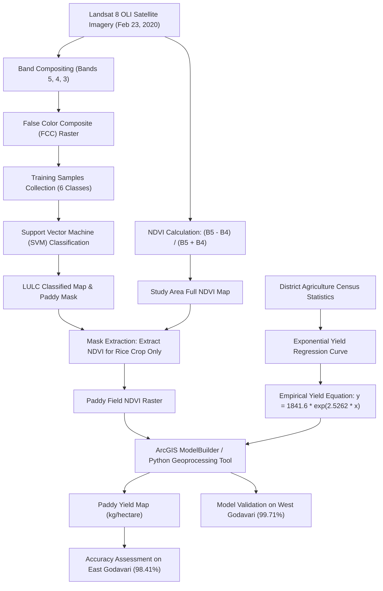

# Methodology & Geoprocessing Workflow

The core objective of this project is to develop an automated geoprocessing model that predicts and maps paddy crop yield at field scale using single-date satellite-derived Normalized Difference Vegetation Index (NDVI) values.

## End-to-End Workflow

## Detailed Processing Steps

### 1. Data Collection & Preprocessing
- **Satellite Scene**: Landsat 8 OLI acquired on February 23, 2020, coinciding with the peak vegetative/flowering stage of Rabi paddy.
- **Administrative Clipping**: Imagery clipped to the boundaries of East Godavari and West Godavari districts under the projected CRS WGS 1984 UTM Zone 44N.

### 2. False Color Composite (FCC) Generation
- Standard FCC bands:
  - Red Channel $\rightarrow$ Band 5 (Near-Infrared: $0.85 - 0.88\,\mu m$)
  - Green Channel $\rightarrow$ Band 4 (Red: $0.64 - 0.67\,\mu m$)
  - Blue Channel $\rightarrow$ Band 3 (Green: $0.53 - 0.59\,\mu m$)
- **Purpose**: Healthy vegetation with abundant chlorophyll exhibits high reflectance in NIR and strong absorption in Red, showing up as vibrant bright red signatures.

### 3. Crop Classification via Machine Learning (SVM)
To separate paddy fields from other land use classes, a Support Vector Machine (SVM) classifier was trained using representative polygons:

| Class Index | Class Name | FCC Visual Signature |
|---|---|---|
| 1 | Rice Crop (Paddy) | Bright Red |
| 2 | Other Vegetation & Crops | Dark Red / Burgundy |
| 3 | Fallow / Barren Land | Pinkish Yellow |
| 4 | Built-up / Settlements | Cyan / Light Blue |
| 5 | Waterbodies | Deep Blue / Black |
| 6 | Sandbars & Riverbanks | Bright White |

- **SVM Tool**: ArcMap `Train Support Vector Machine Classifier` & `Classify Raster`.
- **Area Assessment**: Pixel count multiplied by cell area ($30\,m \times 30\,m = 900\,m^2$) converted to hectares.
  $$\text{Observed Area} = 150,485.8\,\text{ha} \quad \text{vs} \quad \text{Actual Area} = 166,544\,\text{ha} \quad (\text{Accuracy} = 90.35\%)$$

### 4. NDVI Computation & Rice Crop Extraction
- Normalized Difference Vegetation Index computed on Landsat 8:
  $$\text{NDVI} = \frac{\text{Band 5} - \text{Band 4}}{\text{Band 5} + \text{Band 4}}$$
- Con / Raster Masking: Only pixels classified as **Rice Crop** were retained:
  $$\text{Crop\_NDVI} = \text{Con}(\text{Classified\_LULC} == \text{Rice}, \text{NDVI})$$

### 5. Empirical Yield Regression & Tool Modeling
- Empirical points relating mean, minimum, and maximum NDVI to recorded paddy yield yielded the exponential fit:
  $$\text{Yield} = 1841.6 \times e^{2.5262 \times \text{NDVI}} \quad (R^2 = 0.9922)$$
- Embedded inside an ArcGIS ModelBuilder geoprocessing tool (`Rice_Yield.tbx`) and ArcPy/Python script.

### 6. Accuracy Assessment & Spatial Transferability
- Evaluated against government yield data for East Godavari ($98.41\%$ accuracy).
- Validated on the adjacent delta district of West Godavari, achieving $99.71\%$ accuracy.
